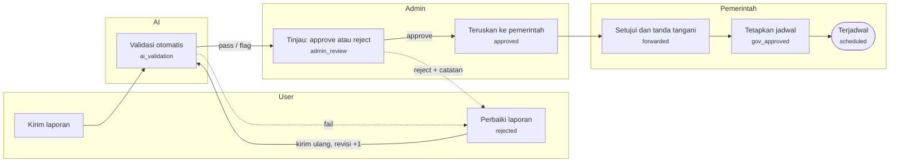
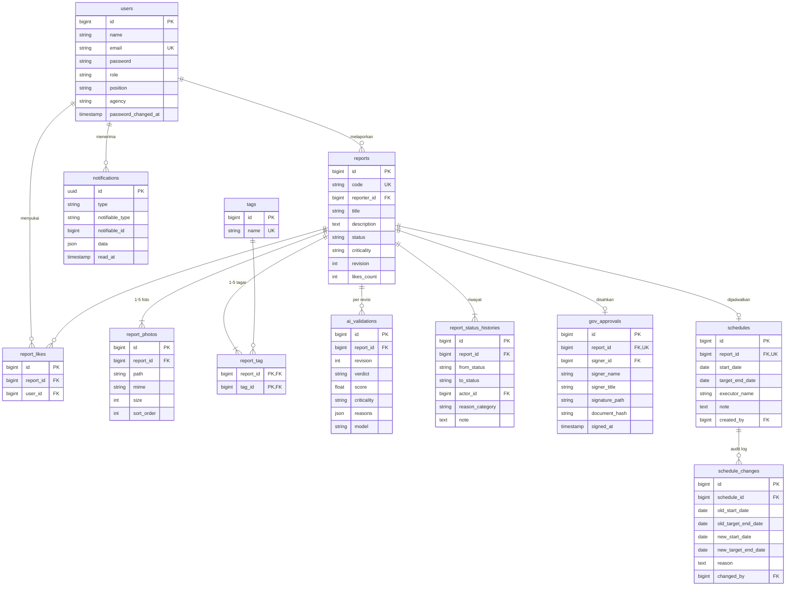

# PRD Backend — GovFac-Report

Versi 12 November 2026. Acuan pengerjaan backend: user flow, ERD, API contract, dan transisi status. Semua path relatif terhadap folder `backend/`.

## Ringkasan

Backend GovFac-Report menyediakan satu API untuk tiga peran (User, Admin, Pemerintah) yang membawa laporan kerusakan fasilitas umum dari warga sampai terjadwal untuk diperbaiki.

**Masalah.** Banyak fasilitas umum di Surabaya rusak dan tidak terurus. Aplikasi pelaporan serupa lambat memvalidasi laporan dan terlalu rumit, sehingga pemerintah enggan memakainya.

**Solusi dari sisi backend.**

- Validasi AI berjalan sesaat setelah laporan dikirim, sehingga admin hanya memeriksa laporan yang sudah tersaring.
- Pemerintah hanya menerima laporan yang sudah disetujui admin, tanpa perlu menyaring sendiri.
- Setiap perubahan status dan jadwal tercatat, dan jadwal tidak bisa dihapus, agar komitmen perbaikan dapat dipertanggungjawabkan ke publik.

## Tujuan dan lingkup

PRD ini mencakup seluruh logika backend untuk PBI-1 sampai PBI-22; deploy sengaja ditunda ke sprint berikutnya.

**Tujuan**

- Satu REST API yang melayani ketiga peran dengan hak akses terpisah.
- Laporan bergerak melalui status yang jelas, dan setiap transisi hanya bisa dipicu oleh peran yang berwenang.
- Hasil validasi AI tersedia sebelum admin membuka laporan.
- Riwayat status dan perubahan jadwal tersimpan permanen dan tidak bisa diubah.

**Termasuk lingkup**

- Autentikasi, otorisasi berbasis peran, dan notifikasi dalam aplikasi.
- Pengelolaan laporan: buat, edit, batal, like, cari, dan filter.
- Validasi AI, verifikasi admin, persetujuan dan tanda tangan pemerintah, penjadwalan.
- Pembuatan PDF laporan dan penyimpanan foto bukti.
- Statistik untuk dashboard User dan Admin.

**Di luar lingkup saat ini**

- Deploy, CI/CD, dan infrastruktur produksi (PBI deploy dikosongkan untuk sprint berikutnya).
- Tampilan frontend dan desain UI.
- Integrasi langsung ke sistem milik pemerintah di luar aplikasi ini; penyaluran dilakukan di dalam aplikasi dan lewat PDF.
- Pelacakan pengerjaan di lapangan setelah jadwal ditetapkan.

## Peran dan hak akses

Setiap akun memiliki tepat satu peran, dan backend menolak permintaan di luar hak peran tersebut dengan `403`.

| Peran | Cara akun dibuat | Boleh | Tidak boleh |
| --- | --- | --- | --- |
| User (warga) | Registrasi mandiri | Membuat, mengedit, dan membatalkan laporan miliknya; melihat dan memberi like laporan orang lain; mengunduh PDF laporannya | Mengubah status laporan; melihat data pribadi pelapor lain |
| Admin | Dibuat lewat seed atau oleh admin lain | Melihat semua laporan; approve atau reject dengan catatan; export PDF; meneruskan ke pemerintah | Mengubah isi laporan warga; menandatangani atau menjadwalkan |
| Pemerintah | Dibuat oleh admin | Melihat laporan yang sudah diteruskan admin; menyetujui dan menandatangani; membuat dan mengubah jadwal | Melihat laporan yang belum lolos admin; menghapus jadwal |

Aturan kepemilikan: User hanya bisa mengubah laporan dengan `reporter_id` miliknya sendiri. Laporan orang lain tampil di feed komunitas tanpa email atau data kontak pelapor.

## Arsitektur dan tech stack

Backend dibangun dengan Laravel 13 sebagai modular monolith: satu aplikasi, dipecah menjadi modul per domain, dan setiap modul memakai lapisan yang sama, sehingga tiap anggota tim bisa memegang satu modul.

| Komponen | Pilihan |
| --- | --- |
| Framework | Laravel 13, PHP 8.3 atau lebih baru |
| Autentikasi | JWT yang disimpan di cookie httpOnly (paket php-open-source-saver/jwt-auth, kompatibilitas dengan Laravel 13 perlu dicek saat instalasi) |
| Basis data | PostgreSQL 16 (asumsi, lihat pertanyaan terbuka) |
| Antrean dan cache | Redis dengan Laravel Queue, untuk validasi AI, PDF, dan notifikasi |
| Penyimpanan berkas | Laravel Filesystem: disk lokal saat pengembangan, S3-compatible nanti |
| PDF | `barryvdh/laravel-dompdf` |
| Kontainer | Docker multi-stage build dan Docker Compose |

### Modul

| Modul | PBI | Tanggung jawab | Tabel yang dimiliki |
| --- | --- | --- | --- |
| Auth | 1, 2 | Registrasi, login, logout, reset password, pembuatan akun admin dan pemerintah | `users` |
| Notification | 3, 14 | Menyimpan dan menyajikan notifikasi; mendengarkan event dari modul lain | `notifications` |
| Report | 5, 7, 8, 9, 10 | Buat, edit, batal, detail, riwayat status, PDF; satu-satunya pemilik transisi status | `reports`, `report_photos`, `tags`, `report_tag`, `report_status_histories` |
| AiValidation | 6 | Job validasi AI dan penyimpanan hasilnya | `ai_validations` |
| Community | 11, 12 | Feed, like, pencarian, dan filter | `report_likes` |
| Verification | 15, 16, 17 | Antrean dan riwayat admin, approve, reject, teruskan ke pemerintah | tidak ada |
| Government | 18, 19, 20, 21, 22 | Daftar laporan pemerintah, persetujuan bertanda tangan, jadwal, audit perubahan jadwal | `gov_approvals`, `schedules`, `schedule_changes` |
| Analytics | 4, 13 | Statistik pribadi dan statistik admin (hanya membaca) | tidak ada |
| Shared | semua | Enum status, format respons, penanganan error, helper berkas | tidak ada |

### Lapisan di dalam setiap modul

```
app/Modules/Report/
  Http/
    Controllers/     menerima request, memanggil service, mengembalikan Resource
    Requests/        FormRequest: validasi dan otorisasi input
    Resources/       bentuk JSON keluaran
  Services/          aturan bisnis dan transaksi
  Repositories/      seluruh query Eloquent
  Models/            model Eloquent dan relasi
  Policies/          hak akses per objek
  Events/ Listeners/ Jobs/
  Contracts/         interface yang boleh dipakai modul lain
  Database/          Migrations, Factories, Seeders
  Routes/api.php
  Tests/
  Providers/ReportServiceProvider.php
```

Aturan antar lapisan dan antar modul:

- Arah panggilan hanya satu: Controller ke Service ke Repository ke Model. Controller tidak berisi query dan Service tidak menyentuh `Request`.
- Modul lain hanya boleh memakai interface di `Contracts/` atau mendengarkan event; tidak mengimpor Service, Repository, atau Model modul lain secara langsung.
- Status laporan hanya berubah lewat `ReportStatusService` di modul Report, yang memeriksa transisi dan menulis riwayat dalam satu transaksi.
- Setiap modul mendaftarkan route, migration, dan binding miliknya lewat ServiceProvider sendiri, sehingga pekerjaan antar anggota jarang bentrok di berkas yang sama.
- Event utama: `ReportSubmitted`, `ReportValidated`, `ReportDecided`, `ReportForwarded`, `ReportGovApproved`, `ScheduleCreated`, `ScheduleChanged`. Modul Notification dan AiValidation bereaksi terhadap event ini.

### Docker multi-stage build

Satu `Dockerfile` menghasilkan image pengembangan dan image produksi dari dasar yang sama; deploy-nya sendiri tetap ditunda.

| Stage | Dasar | Isi |
| --- | --- | --- |
| `vendor` | `composer:2` | `composer install --no-dev` dengan cache layer dari `composer.json` dan `composer.lock` |
| `base` | `php:8.3-fpm-alpine` | Ekstensi PHP: `pdo_pgsql`, `redis`, `gd`, `zip`, `intl`, `opcache` |
| `dev` | `base` | Composer, dependensi dev, Xdebug; kode di-mount sebagai volume |
| `production` | `base` | Salinan kode dan `vendor` dari stage `vendor`, cache config dan route, user non-root |

Docker Compose untuk pengembangan lokal menjalankan lima layanan: `app` (PHP-FPM, target `dev`), `nginx`, `postgres`, `redis`, dan `queue` (worker dari image yang sama).

## User flow per peran

Satu laporan berpindah dari User ke AI, ke Admin, lalu ke Pemerintah, dan hanya bisa kembali ke User lewat penolakan.



Teks kecil di tiap kotak adalah status laporan selama menunggu di langkah itu. Penolakan oleh AI maupun admin sama-sama berakhir di "Perbaiki laporan", dan hasil perbaikan divalidasi ulang dari awal.

### User

1. Registrasi lalu login (`POST /auth/register`, `POST /auth/login`); notifikasi login tercatat.
2. Membuka dashboard: statistik pribadi (`GET /me/report-stats`) dan daftar laporannya (`GET /reports/mine`).
3. Mengisi formulir dan mengirim laporan (`POST /reports`); laporan masuk `ai_validation`.
4. Memantau status dan linimasa (`GET /reports/{id}`, `GET /reports/{id}/history`).
5. Jika ditolak: membaca catatan, memperbaiki, dan mengirim ulang (`PUT /reports/{id}`).
6. Jika masalah sudah selesai sendiri: membatalkan laporan (`POST /reports/{id}/cancel`), selama belum disetujui pemerintah.
7. Kapan saja: menjelajah feed, mencari, memfilter, dan memberi like (`GET /feed`, `PUT /reports/{id}/like`).
8. Mengunduh PDF laporannya (`GET /reports/{id}/pdf`) dan melihat jadwal setelah ditetapkan (`GET /reports/{id}/schedule`).

### Admin

1. Login; lencana notifikasi menunjukkan laporan baru (`GET /notifications/unread-count`).
2. Membuka dashboard statistik (`GET /admin/stats`).
3. Membuka antrean aktif, terurut dari like terbanyak (`GET /admin/reports/queue`).
4. Membuka detail laporan beserta hasil AI (`GET /admin/reports/{id}`).
5. Memutuskan: approve (`POST .../approve`) atau reject dengan kategori alasan dan catatan (`POST .../reject`). Laporan otomatis pindah ke riwayat.
6. Untuk laporan yang disetujui: mengunduh PDF dan meneruskan ke pemerintah (`POST .../forward`).
7. Meninjau riwayat keputusan (`GET /admin/reports/history`).

### Pemerintah

1. Login dengan akun yang dibuat admin.
2. Membuka dashboard: hanya laporan yang sudah diteruskan admin (`GET /gov/reports`).
3. Membuka antrean laporan yang menunggu persetujuan (`GET /gov/reports/queue`) dan detailnya.
4. Menyetujui dan membubuhkan tanda tangan (`POST /gov/reports/{id}/approve`); PDF resmi dibuat ulang.
5. Menetapkan jadwal pengerjaan (`POST /gov/reports/{id}/schedule`); pelapor menerima notifikasi.
6. Bila perlu, mengubah atau memundurkan tanggal dengan alasan (`PATCH /gov/reports/{id}/schedule`); jadwal tidak bisa dihapus.

### Transisi status

Transisi di luar tabel ini ditolak dengan `409`.

| Dari | Ke | Pemicu | Syarat |
| --- | --- | --- | --- |
| (baru) | `ai_validation` | User | Formulir lolos validasi input |
| `ai_validation` | `admin_review` | Sistem | Verdict AI `pass` atau `flag` |
| `ai_validation` | `rejected` | Sistem | Verdict AI `fail`, alasan disimpan sebagai catatan |
| `admin_review` | `approved` | Admin |  |
| `admin_review` | `rejected` | Admin | Kategori alasan dan catatan wajib |
| `rejected` | `ai_validation` | User pemilik | Laporan diedit; `revision` bertambah 1 |
| `approved` | `forwarded` | Admin |  |
| `forwarded` | `gov_approved` | Pemerintah | Tanda tangan terlampir |
| `gov_approved` | `scheduled` | Pemerintah | Jadwal valid |
| `ai_validation`, `admin_review`, `approved`, `forwarded` | `cancelled` | User pemilik |  |

`cancelled` dan `scheduled` adalah status akhir. Mengubah jadwal tidak mengubah status.

## Kebutuhan fungsional

Setiap PBI di bawah diterjemahkan menjadi perilaku backend dan kriteria penerimaan yang bisa diuji lewat API.

### User (PBI-1 sampai PBI-12)

| PBI | Perilaku backend | Kriteria penerimaan |
| --- | --- | --- |
| PBI-1 Registrasi & Login | Registrasi dengan nama, email, dan password. Login memasang JWT di cookie httpOnly dan mengembalikan data user beserta perannya; token tidak pernah muncul di body respons. | Email ganda ditolak `422`. Password minimal 8 karakter dan disimpan sebagai hash. Kredensial salah dijawab `401` dengan pesan yang sama untuk email maupun password. |
| PBI-2 Lupa Password | Permintaan reset mengirim tautan bertoken ke email. Token dipakai untuk menetapkan password baru. | Jawaban selalu `200`, terdaftar atau tidak. Token berlaku 30 menit dan sekali pakai. Setelah reset, semua token lama dicabut. |
| PBI-3 Notifikasi Login | Setiap login berhasil membuat notifikasi berisi waktu dan perangkat. | Notifikasi muncul di daftar notifikasi user paling lambat 5 detik setelah login. |
| PBI-4 Statistik Laporan Pribadi | Mengembalikan jumlah laporan user: total diajukan, disetujui, ditolak, dan masih diproses. | Angka sama dengan hasil hitung laporan milik user tersebut. Laporan dibatalkan dihitung terpisah. |
| PBI-5 Formulir Laporan | Menerima judul, deskripsi, 1 sampai 5 foto bukti, dan 1 sampai 5 tagar kategori. | Judul maksimal 100 karakter, deskripsi maksimal 2.000. Foto hanya JPEG atau PNG, maksimal 5 MB per berkas. Laporan tersimpan dengan status `ai_validation`. |
| PBI-6 AI Validasi Laporan | Laporan baru atau hasil edit masuk antrean validasi AI secara otomatis. | Hasil tersimpan paling lambat 60 detik. User tidak menunggu: respons pengiriman kembali sebelum validasi selesai. |
| PBI-7 Status Laporan | Mengembalikan status terkini dan linimasa seluruh perubahan status beserta waktu, pelaku, dan catatan. | Setiap transisi menambah tepat satu baris riwayat. Catatan penolakan terlihat oleh pelapor. |
| PBI-8 Edit Laporan | Pelapor mengubah isi laporan yang berstatus `rejected`, lalu laporan kembali ke `ai_validation`. | Edit pada status lain ditolak `409`. Catatan admin sebelumnya tetap ada di riwayat. Nomor revisi bertambah 1. |
| PBI-9 Pembatalan Laporan | Pelapor membatalkan laporannya selama pemerintah belum menyetujui. | Berhasil pada `ai_validation`, `admin_review`, `approved`, `forwarded`. Ditolak `409` mulai `gov_approved`. Status `cancelled` bersifat final. |
| PBI-10 Unduh PDF Laporan | Menghasilkan PDF berisi nomor laporan, isi, foto, status, dan riwayat. | Hanya pelapor, admin, dan pemerintah yang bisa mengunduh. PDF memuat tanggal cetak. |
| PBI-11 Report and Like Activity | Feed komunitas menampilkan laporan yang sudah lolos validasi AI. User memberi atau mencabut like. | Satu user satu like per laporan; permintaan berulang tidak menambah hitungan. Laporan `rejected` dan `cancelled` tidak tampil di feed. |
| PBI-12 Filtering Report Activity | Feed mendukung pencarian teks, filter status, criticality, dan tagar, serta urutan berdasarkan like terbanyak atau terbaru. | Filter bisa digabung. Hasil berhalaman, 20 item per halaman secara bawaan. |

### Admin (PBI-13 sampai PBI-17)

| PBI | Perilaku backend | Kriteria penerimaan |
| --- | --- | --- |
| PBI-13 Statistik Laporan Pengguna | Mengembalikan jumlah laporan masuk, disetujui, dan ditolak, serta rincian penolakan per kategori alasan. | Bisa dibatasi rentang tanggal. Jumlah per kategori alasan sama dengan total ditolak. |
| PBI-14 Notifikasi Laporan Masuk | Laporan yang masuk `admin_review` membuat notifikasi untuk semua admin. Tersedia endpoint jumlah belum dibaca. | Notifikasi muncul paling lambat 5 detik setelah validasi AI selesai. Menandai dibaca hanya berlaku untuk admin itu sendiri. |
| PBI-15 Detail Report | Admin melihat isi laporan, foto, hasil AI, dan jumlah like, lalu memutuskan approve atau reject. | Reject wajib menyertakan kategori alasan dan catatan minimal 10 karakter. Keputusan hanya bisa diambil pada status `admin_review`. Pelapor menerima notifikasi. |
| PBI-16 Auto Switch Status Report | Antrean aktif adalah laporan berstatus `admin_review`; riwayat adalah laporan yang sudah diputuskan. Tidak ada aksi pindah manual. | Laporan hilang dari antrean dan muncul di riwayat pada permintaan berikutnya setelah keputusan. Antrean diurutkan dari like terbanyak, lalu yang paling lama menunggu. |
| PBI-17 Export PDF & Government Submission | Admin mengunduh PDF laporan `approved` dan meneruskannya ke pemerintah, sehingga status menjadi `forwarded`. | Hanya laporan `approved` yang bisa diteruskan. Akun pemerintah menerima notifikasi. Meneruskan dua kali ditolak `409`. |

### Pemerintah (PBI-18 sampai PBI-22)

| PBI | Perilaku backend | Kriteria penerimaan |
| --- | --- | --- |
| PBI-18 Simple Dashboard (Report List) | Mengembalikan daftar laporan berstatus `forwarded`, `gov_approved`, dan `scheduled`. | Laporan pada status lain tidak pernah muncul, termasuk lewat akses langsung dengan ID (`404`). |
| PBI-19 Verified Reports Dashboard | Antrean kerja pemerintah: laporan `forwarded` yang menunggu persetujuan, dengan detail lengkap dan PDF. | Diurutkan dari criticality tertinggi, lalu like terbanyak. |
| PBI-20 Digital Signature & Report Approval | Pejabat menyetujui laporan dan membubuhkan tanda tangan. Backend menyimpan gambar tanda tangan, nama, jabatan, waktu, dan hash dokumen, lalu membuat ulang PDF. | Hanya pada status `forwarded`. PDF baru memuat blok pengesahan. Status menjadi `gov_approved` dan persetujuan tidak bisa dicabut. |
| PBI-21 Work Scheduling | Pemerintah menetapkan tanggal mulai, target selesai, dan pelaksana untuk laporan `gov_approved`. | Tanggal mulai tidak boleh di masa lalu; target selesai tidak boleh sebelum tanggal mulai. Satu laporan satu jadwal. Status menjadi `scheduled`, pelapor menerima notifikasi, dan jadwal tampil di feed. |
| PBI-22 Schedule Adjustment & Audit Log | Pemerintah mengubah tanggal jadwal dengan alasan wajib. Setiap perubahan dicatat: nilai lama, nilai baru, pelaku, waktu, alasan. | Tidak ada endpoint hapus jadwal (`405`). Catatan audit tidak bisa diubah atau dihapus dan bisa dibaca publik pada laporan tersebut. |

## Model data (ERD)

Model data terdiri dari 12 tabel domain dengan `reports` sebagai pusat, ditambah tabel bawaan Laravel (`password_reset_tokens`, `jobs`, `failed_jobs`). JWT tidak memerlukan tabel token; blacklist-nya disimpan di Redis.



Tipe kolom di diagram bersifat indikatif; yang mengikat adalah migration. Relasi pelaku ke `users` (`actor_id`, `signer_id`, `created_by`, `changed_by`) tidak digambar agar garis tidak bersilangan; semuanya tercantum di tabel berikut.

| Tabel | Field | Catatan |
| --- | --- | --- |
| `users` | `id`, `name`, `email`, `password`, `role`, `position`, `agency`, `email_verified_at`, timestamps | `email` unik. `role`: `user`, `admin`, `government`. `position` dan `agency` hanya untuk akun pemerintah. Ditambah kolom password\_changed\_at: JWT yang terbit sebelum waktu ini ditolak, sehingga reset password mencabut semua sesi lama. |
| `reports` | `id`, `code`, `reporter_id`, `title`, `description`, `status`, `criticality`, `revision`, `likes_count`, timestamps | `code` unik, format `GFR-YYYY-NNNNNN`. `reporter_id` ke `users`. Indeks pada `status`, `reporter_id`, `likes_count`. `criticality` boleh kosong sebelum validasi AI. |
| `report_photos` | `id`, `report_id`, `path`, `mime`, `size`, `sort_order`, `created_at` | 1 sampai 5 baris per laporan. |
| `tags` | `id`, `name`, `created_at` | `name` unik, huruf kecil, tanpa tanda pagar. |
| `report_tag` | `report_id`, `tag_id` | Primary key gabungan. |
| `report_likes` | `id`, `report_id`, `user_id`, `created_at` | Unik pada (`report_id`, `user_id`). |
| `ai_validations` | `id`, `report_id`, `revision`, `verdict`, `score`, `criticality`, `reasons` (json), `model`, `created_at` | Satu baris per revisi laporan. `verdict`: `pass`, `flag`, `fail`. |
| `report_status_histories` | `id`, `report_id`, `from_status`, `to_status`, `actor_id`, `reason_category`, `note`, `created_at` | Hanya tambah, tidak pernah diubah. `actor_id` kosong berarti sistem. `reason_category` diisi saat reject. |
| `gov_approvals` | `id`, `report_id`, `signer_id`, `signer_name`, `signer_title`, `signature_path`, `document_hash`, `signed_at` | `report_id` unik. `document_hash` adalah SHA-256 dari PDF yang ditandatangani. |
| `schedules` | `id`, `report_id`, `start_date`, `target_end_date`, `executor_name`, `note`, `created_by`, timestamps | `report_id` unik. Tidak memakai soft delete dan tidak punya aksi hapus. |
| `schedule_changes` | `id`, `schedule_id`, `old_start_date`, `old_target_end_date`, `new_start_date`, `new_target_end_date`, `reason`, `changed_by`, `created_at` | Hanya tambah. Inilah audit log PBI-22. |
| `notifications` | `id` (uuid), `type`, `notifiable_type`, `notifiable_id`, `data` (json), `read_at`, timestamps | Tabel notifikasi bawaan Laravel. |

Nilai enum:

- `reports.status`: `ai_validation`, `admin_review`, `rejected`, `approved`, `forwarded`, `gov_approved`, `scheduled`, `cancelled`.
- `criticality`: `low`, `medium`, `high`.
- `reason_category`: `duplicate`, `unclear_evidence`, `not_public_facility`, `incomplete`, `other`.

## API contract

Semua endpoint berada di bawah `/api/v1` dan berformat JSON. Autentikasi memakai JWT di cookie httpOnly `access_token` yang dikirim otomatis oleh browser (`credentials: include`); frontend tidak pernah membaca atau menyimpan token. Endpoint bertanda publik tidak memerlukan cookie.

### Konvensi

- Respons sukses dibungkus `data`; daftar berhalaman menambah `meta` (`current_page`, `per_page`, `total`, `last_page`).
- Respons error berisi `message`, dan untuk validasi ditambah `errors` per field (format bawaan FormRequest).
- Paginasi lewat `page` dan `per_page` (bawaan 20, maksimal 50).
- Waktu memakai ISO 8601 UTC; tanggal jadwal memakai `YYYY-MM-DD`.
- Unggah berkas memakai `multipart/form-data`. Edit laporan dengan berkas dikirim sebagai `POST` dengan `_method=PUT`.

| Kode | Arti |
| --- | --- |
| `200` / `201` | Berhasil / berhasil dibuat |
| `401` | Cookie JWT tidak ada, tidak sah, atau kedaluwarsa |
| `403` | Peran atau kepemilikan tidak mengizinkan |
| `404` | Tidak ditemukan, atau tidak boleh diketahui keberadaannya |
| `405` | Metode tidak disediakan (misalnya hapus jadwal) |
| `409` | Aksi tidak sah untuk status laporan saat ini |
| `422` | Validasi input gagal |
| `429` | Terlalu banyak permintaan |

### Auth dan Notification

| Metode | Path | Akses | Fungsi | Body atau query utama |
| --- | --- | --- | --- | --- |
| POST | `/auth/register` | Publik | Registrasi warga | `name`, `email`, `password`, `password_confirmation` |
| POST | `/auth/login` | Publik | Login; memasang cookie `access_token` (httpOnly) dan `XSRF-TOKEN`, mengembalikan `user` | `email`, `password` |
| POST | `/auth/refresh` | Semua peran | Menukar JWT yang masih dalam masa refresh dengan yang baru; cookie diganti |  |
| POST | `/auth/logout` | Semua peran | Memasukkan JWT ke blacklist dan menghapus cookie |  |
| GET | `/auth/me` | Semua peran | Profil dan peran akun |  |
| POST | `/auth/forgot-password` | Publik | Mengirim tautan reset | `email` |
| POST | `/auth/reset-password` | Publik | Menetapkan password baru | `token`, `email`, `password`, `password_confirmation` |
| POST | `/admin/users` | Admin | Membuat akun admin atau pemerintah | `name`, `email`, `role`, `position`, `agency` |
| GET | `/notifications` | Semua peran | Daftar notifikasi milik sendiri | `unread` |
| GET | `/notifications/unread-count` | Semua peran | Jumlah belum dibaca |  |
| PATCH | `/notifications/{id}/read` | Semua peran | Tandai satu dibaca |  |
| PATCH | `/notifications/read-all` | Semua peran | Tandai semua dibaca |  |

### Report, Community, dan Analytics (User)

| Metode | Path | Akses | Fungsi | Body atau query utama |
| --- | --- | --- | --- | --- |
| POST | `/reports` | User | Membuat laporan, status awal `ai_validation` | `title`, `description`, `photos[]`, `tags[]` |
| GET | `/reports/mine` | User | Laporan milik sendiri | `status` |
| GET | `/reports/{id}` | Pemilik, Admin, Pemerintah; User lain bila laporan ada di feed | Detail laporan |  |
| PUT | `/reports/{id}` | Pemilik | Edit laporan `rejected`, kembali ke `ai_validation` | sama dengan buat laporan |
| POST | `/reports/{id}/cancel` | Pemilik | Membatalkan laporan | `reason` (opsional) |
| GET | `/reports/{id}/history` | Sama dengan detail | Linimasa perubahan status |  |
| GET | `/reports/{id}/schedule` | Sama dengan detail | Jadwal dan catatan perubahannya |  |
| GET | `/reports/{id}/pdf` | Pemilik, Admin, Pemerintah | Unduh PDF laporan |  |
| GET | `/feed` | Semua peran | Feed komunitas | `q`, `status`, `criticality`, `tag`, `sort` (`likes` atau `newest`) |
| PUT | `/reports/{id}/like` | User | Memberi like (idempoten) |  |
| DELETE | `/reports/{id}/like` | User | Mencabut like |  |
| GET | `/tags` | Semua peran | Saran tagar kategori | `q` |
| GET | `/me/report-stats` | User | Statistik laporan pribadi |  |

### Verification dan Analytics (Admin)

| Metode | Path | Akses | Fungsi | Body atau query utama |
| --- | --- | --- | --- | --- |
| GET | `/admin/stats` | Admin | Statistik masuk, disetujui, ditolak, dan rincian alasan | `from`, `to` |
| GET | `/admin/reports/queue` | Admin | Antrean aktif (`admin_review`) |  |
| GET | `/admin/reports/history` | Admin | Riwayat laporan yang sudah diputuskan | `decision`, `from`, `to` |
| GET | `/admin/reports/{id}` | Admin | Detail lengkap beserta hasil AI |  |
| POST | `/admin/reports/{id}/approve` | Admin | `admin_review` menjadi `approved` | `note` (opsional) |
| POST | `/admin/reports/{id}/reject` | Admin | `admin_review` menjadi `rejected` | `reason_category`, `note` |
| POST | `/admin/reports/{id}/forward` | Admin | `approved` menjadi `forwarded` |  |

### Government (Pemerintah)

| Metode | Path | Akses | Fungsi | Body atau query utama |
| --- | --- | --- | --- | --- |
| GET | `/gov/reports` | Pemerintah | Semua laporan `forwarded`, `gov_approved`, `scheduled` | `status` |
| GET | `/gov/reports/queue` | Pemerintah | Laporan `forwarded` yang menunggu persetujuan |  |
| GET | `/gov/reports/{id}` | Pemerintah | Detail laporan |  |
| POST | `/gov/reports/{id}/approve` | Pemerintah | Menyetujui dan menandatangani, menjadi `gov_approved` | `signature` (PNG), `signer_name`, `signer_title` |
| POST | `/gov/reports/{id}/schedule` | Pemerintah | Membuat jadwal, menjadi `scheduled` | `start_date`, `target_end_date`, `executor_name`, `note` |
| PATCH | `/gov/reports/{id}/schedule` | Pemerintah | Mengubah tanggal jadwal, tercatat di audit | `start_date`, `target_end_date`, `reason` |

### Bentuk objek utama

Objek laporan, dipakai di detail dan sebagai item daftar (daftar tidak memuat `description` dan `photos` selain yang pertama):

```json
{
  "data": {
    "id": 123,
    "code": "GFR-2026-000123",
    "title": "Lampu jalan mati di Jl. Darmo",
    "description": "Tiga lampu mati sejak dua minggu.",
    "status": "admin_review",
    "criticality": "medium",
    "revision": 1,
    "tags": ["lampujalan", "penerangan"],
    "photos": [{ "id": 9, "url": "https://.../photos/9.jpg" }],
    "likes_count": 42,
    "liked_by_me": true,
    "reporter": { "id": 7, "name": "Budi" },
    "schedule": null,
    "created_at": "2026-11-12T03:10:00Z",
    "updated_at": "2026-11-12T03:11:05Z"
  }
}
```

Error validasi (`422`) dan error transisi status (`409`):

```json
{
  "message": "The title field is required.",
  "errors": { "title": ["The title field is required."] }
}
```

```json
{
  "message": "Laporan berstatus gov_approved tidak bisa dibatalkan.",
  "code": "invalid_status_transition",
  "current_status": "gov_approved"
}
```

## Validasi AI

Validasi AI berjalan sebagai job antrean setelah laporan dibuat atau diedit, dan hasilnya menentukan apakah laporan masuk antrean admin atau dikembalikan ke pelapor.

**Yang diperiksa**

- Foto memang menunjukkan fasilitas umum atau infrastruktur, dan kerusakannya terlihat.
- Judul, deskripsi, dan tagar sesuai dengan isi foto.
- Laporan bukan spam, tidak memuat konten tidak pantas, dan bukan duplikat persis dari laporan aktif milik pelapor yang sama.

**Keluaran** (disimpan di `ai_validations`)

| Field | Isi |
| --- | --- |
| `verdict` | `pass` (layak), `flag` (ragu, admin perlu teliti), `fail` (tidak layak) |
| `score` | Tingkat keyakinan 0 sampai 1 |
| `criticality` | `low`, `medium`, atau `high`; disalin ke `reports.criticality` |
| `reasons` | Daftar alasan singkat, ditampilkan ke admin dan, bila `fail`, ke pelapor |

**Perilaku**

- `pass` dan `flag` memindahkan laporan ke `admin_review`; `fail` memindahkannya ke `rejected` dengan pelaku sistem.
- Job dicoba ulang maksimal 3 kali. Jika tetap gagal atau melewati 60 detik, laporan diteruskan ke `admin_review` dengan verdict `flag` dan alasan "validasi AI tidak tersedia", sehingga laporan tidak pernah tertahan.
- Penyedia AI dibungkus interface `AiValidator` di modul AiValidation, sehingga bisa diganti tanpa menyentuh modul lain dan bisa dipalsukan saat pengujian.

## Kebutuhan non-fungsional

| Area | Kebutuhan |
| --- | --- |
| Keamanan | Password di-hash dengan bcrypt atau Argon2. Access token JWT berlaku 15 menit dan bisa diperbarui sampai 7 hari; token yang di-logout masuk blacklist di Redis. Cookie bersifat httpOnly, Secure, dan SameSite=Lax. Permintaan yang mengubah data wajib membawa header X-XSRF-TOKEN. CORS hanya mengizinkan origin frontend, dengan credentials. Login dan lupa password dibatasi 5 percobaan per menit per IP. |
| Otorisasi | Setiap route memakai middleware peran, dan setiap aksi pada objek memakai Policy. Tidak ada pemeriksaan peran di dalam Controller. |
| Privasi | Email dan data kontak pelapor tidak pernah muncul di feed atau di respons untuk User lain. |
| Berkas | Foto dan tanda tangan diperiksa tipe MIME aslinya, disimpan dengan nama acak, dan diakses lewat URL bertanda tangan untuk berkas non-publik. |
| Performa | Endpoint daftar menjawab di bawah 500 ms untuk 10.000 laporan. Pembuatan PDF dan validasi AI berjalan di antrean, bukan di request. |
| Integritas | Transisi status dan penulisan riwayat berada dalam satu transaksi basis data. `report_status_histories` dan `schedule_changes` hanya bisa ditambah. |
| Pengujian | Setiap modul punya feature test untuk endpoint-nya dan unit test untuk Service. Transisi status diuji lengkap, termasuk yang harus ditolak. |
| Dokumentasi | API contract dijaga sebagai berkas OpenAPI di repositori dan diperbarui bersama perubahan endpoint. |
| Lingkungan | Seluruh layanan berjalan dengan satu perintah `docker compose up`; konfigurasi lewat `.env`, tanpa rahasia di dalam image. |

## Pertanyaan terbuka

Hal berikut belum ditetapkan di backlog; dokumen ini memakai asumsi yang tertulis sampai ada keputusan.

- [ ] **Lokasi laporan.** Formulir di PBI-5 tidak memuat lokasi. Asumsi saat ini: tidak ada field lokasi. Perlu alamat atau koordinat agar dinas tahu tempat perbaikannya?
- [ ] **Wewenang AI.** Asumsi: verdict `fail` langsung menolak laporan. Alternatifnya AI hanya memberi label dan semua keputusan tetap di admin.
- [ ] **Sumber criticality.** Asumsi: ditentukan AI. Apakah admin boleh mengubahnya?
- [ ] **Penyedia AI.** Model dan layanan untuk validasi foto dan teks belum dipilih.
- [ ] **Basis data.** Asumsi PostgreSQL 16; MySQL 8 juga didukung Laravel bila tim lebih terbiasa.
- [ ] **PBI-19.** Tidak ada user story untuk Verified Reports Dashboard. Asumsi: antrean laporan yang menunggu persetujuan pemerintah.
- [ ] **Tanda tangan digital.** Asumsi: gambar tanda tangan ditambah hash dokumen. Apakah perlu tanda tangan elektronik tersertifikasi?
- [ ] **Penolakan oleh pemerintah.** Backlog tidak menyediakan jalur bagi pemerintah untuk menolak laporan yang diteruskan. Perlu ditambah?
- [ ] **Pembagian dinas.** Asumsi: semua akun pemerintah melihat semua laporan yang diteruskan. Apakah laporan perlu diarahkan ke dinas tertentu?
- [ ] **Notifikasi.** Asumsi: hanya di dalam aplikasi dan diambil lewat polling. Perlu email atau push real-time?
- [ ] **Status selesai.** Alur berhenti di `scheduled`. Apakah perlu status pengerjaan selesai di sprint berikutnya?
- [ ] **Prioritas.** PBI-4, 7, 10, 13, dan 18 belum punya prioritas di backlog.
